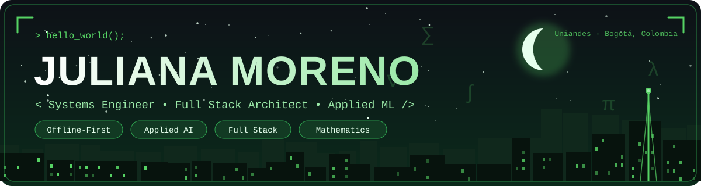
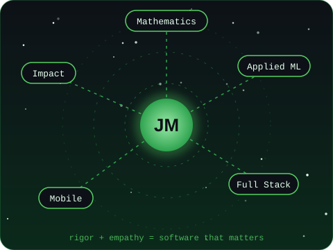
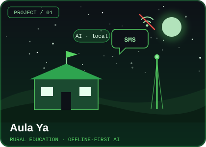
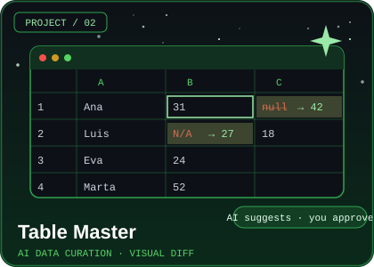
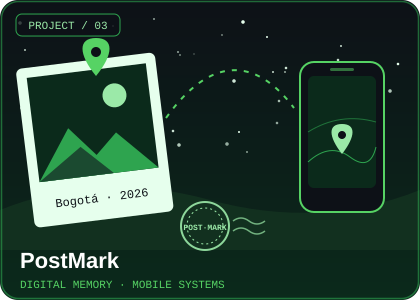

<div align="center">



<a href="https://github.com/Juliana0203">
  
</a>

<br/>

<a href="https://www.linkedin.com/in/juliana-moreno-narv%C3%A1ez-158890446/" target="_blank">
  
</a>
&nbsp;
<a href="mailto:j.morenon2@uniandes.edu.co">
  
</a>
&nbsp;
<a href="https://github.com/Juliana0203" target="_blank">
  
</a>

<br/><br/>


</div>


## 🎯 About Me

<table>
  <tr>
    <td width="52%" valign="top">

```typescript
const juliana = {
  role: "Systems & Computing Engineering Student",
  school: "Universidad de los Andes",
  location: "Colombia 🇨🇴",

  building: [
    "Offline-first AI for rural education",
    "AI-assisted data curation tools",
    "Mobile systems for digital memory",
  ],

  focus: ["Full-Stack Architecture", "Applied ML", "Mobile Systems"],

  mathematics: [
    "Applied Probability", "Stochastic Modeling",
    "Discrete Structures", "Optimization",
  ],

  philosophy: "High-leverage software for deep human challenges",
  offline: ["🏓 Table tennis", "🎮 Videogames", "📚 Reading"],
};
```

</td>
    <td width="48%" valign="top" align="center">
      
    </td>
  </tr>
</table>

I turn complex social and data problems into **accessible, scalable and sustainable** software, from architecture to interface. Rigor from mathematics, empathy from the people who will actually use the tool.


## 🛠️ Tech Stack

<table>
  <tr>
    <td align="center" width="33%"><strong>🤖 Machine Learning &amp; Data</strong></td>
    <td align="center" width="33%"><strong>⚙️ Backend &amp; Cloud</strong></td>
    <td align="center" width="33%"><strong>🌐 Frontend &amp; Tooling</strong></td>
  </tr>
  <tr>
    <td align="center"></td>
    <td align="center"></td>
    <td align="center"></td>
  </tr>
</table>

<div align="center">
  
  
  
  
  
</div>


## 🚀 Featured Projects

<table>
  <tr>
    <td width="33%" valign="top">
      
      <p><em>Closing the rural education gap in Colombia through engineering and accessibility.</em></p>
      <p><strong>The problem.</strong> Rural students accumulate learning gaps year after year, and most digital tools assume a stable internet connection that their schools and homes do not have.</p>
      <p><strong>The solution.</strong> A systems engineering solution that works <strong>without continuous connectivity</strong> and adds <strong>no workload for teachers</strong>, designed to be adopted by the State or international cooperation agencies.</p>
      <ul>
        <li>🧠 <strong>Local &amp; offline AI:</strong> an adaptive tutor that runs without a constant connection.</li>
        <li>📲 <strong>SMS fallback:</strong> coverage for students with basic phones.</li>
        <li>👩‍🏫 <strong>Teacher support:</strong> downloadable curriculum and automatic gap diagnostics.</li>
        <li>🤝 <strong>Sustainable adoption:</strong> built to be deployed at scale by public institutions.</li>
      </ul>
      <p>
        
        
        
        
      </p>
    </td>
    <td width="33%" valign="top">
      
      <p><em>Intuitive spreadsheets powered by AI, so anyone can work with data.</em></p>
      <p><strong>The problem.</strong> Cleaning tabular data usually takes code or fragile manual work, and AI fixes are hard to trust when you cannot see what changed.</p>
      <p><strong>The solution.</strong> A web app that pairs the familiarity of a spreadsheet with AI to <strong>load, edit, clean and export</strong> data without writing code. Every suggestion appears as a visual diff the user reviews and approves.</p>
      <ul>
        <li>🔍 <strong>Automatic detection</strong> of schemas, headers and data types.</li>
        <li>🧹 <strong>Smart cleaning with diff:</strong> AI suggests, the user approves.</li>
        <li>🕘 <strong>Version control:</strong> full history to experiment safely.</li>
        <li>📤 <strong>Flexible export</strong> for analysis and as LLM context.</li>
      </ul>
      <p>
        
        
        
        
      </p>
    </td>
    <td width="33%" valign="top">
      
      <p><em>Bridging tangible and digital memory spaces.</em></p>
      <p><strong>The problem.</strong> Memories live in places and objects, but digital tools store them somewhere else, so the physical and digital sides of a memory drift apart.</p>
      <p><strong>The solution.</strong> A mobile system that connects <strong>real places and physical keepsakes with their digital counterpart</strong>, so experiences can be preserved and relived where they happened.</p>
      <ul>
        <li>🗺️ <strong>Anchored memories</strong> tied to real places and objects.</li>
        <li>📱 <strong>Mobile-first:</strong> designed around the device people carry everywhere.</li>
        <li>🔗 <strong>Digital layer</strong> that complements, not replaces, the physical.</li>
      </ul>
      <p>
        
        
        
      </p>
    </td>
  </tr>
</table>

<div align="center">
  <a href="https://github.com/Juliana0203?tab=repositories">
    
  </a>
</div>


## 📊 GitHub Analytics

<div align="center">
  
  
</div>

<div align="center">
  
  
</div>

<div align="center">
  
  
</div>

<br/>

<div align="center">


<br/>

<a href="https://www.linkedin.com/in/juliana-moreno-narv%C3%A1ez-158890446/">
  
</a>


</div>
